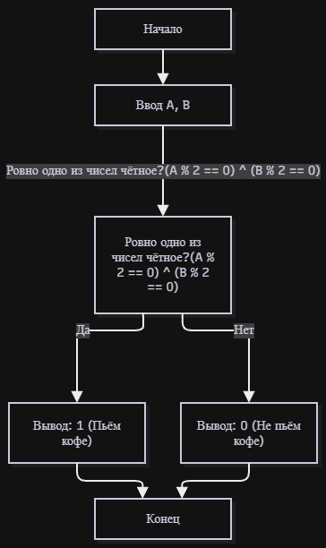

# Домашнее задание к работе 4

## Условие задачи
Два программиста, Анна (A) и Борис (B), дежурят ночью. Чтобы было не так скучно, они решили, что будут пить кофе только если кто-то один из них четный (по номеру своего рабочего места). Запишите условие для кофе-машины.

## 1. Алгоритм и блок-схема

### Алгоритм
1. Начало.
2. Ввести номера рабочих мест A и B.
3. Вычислить условие: ровно один из номеров чётный — `(A % 2 == 0) ^ (B % 2 == 0)`.
4. Вывести результат: 1 — пьём кофе, 0 — не пьём.
5. Конец.

### Блок-схема


## 2. Реализация программы

Файл: [main.c](main.c)

## 3. Результаты работы программы

```
Введите номер рабочего места Анны и Бориса: 11 2
Пьём кофе? (1 - да, 0 - нет): 1
```

```
Введите номер рабочего места Анны и Бориса: 4 8
Пьём кофе? (1 - да, 0 - нет): 0
```

## 4. Информация о разработчике

Плотников Антон, бТИИ-262

